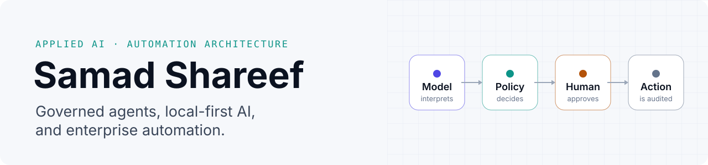
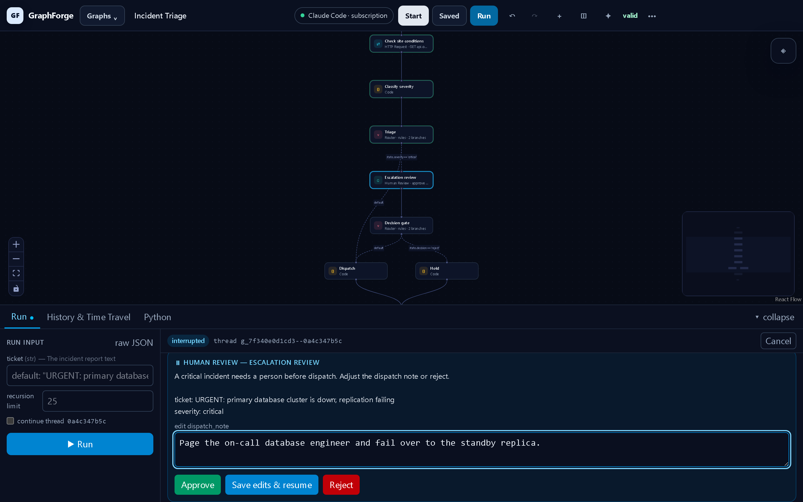
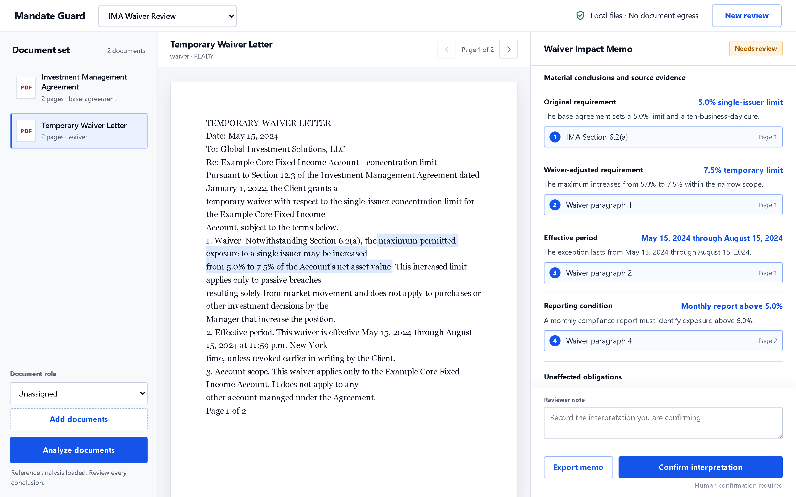

<picture>
  <source media="(prefers-color-scheme: dark)" srcset="assets/hero-dark.svg">
  
</picture>

### Applied AI Engineer · AI & Automation Architect

I turn document, agent and operational workflows into software with explicit controls, review paths and measurable verification. Models interpret and propose. Deterministic code and accountable people own the consequential decisions.

**Owner-reported career impact since 2018:** **$1.5M+** saved · **20,000+** hours saved · **300+** end-to-end automation solutions · **8 years** in enterprise automation. These totals are not independently reproduced in this repository.

Open to senior, principal and lead roles in applied AI engineering and solutions architecture.
**[Portfolio and résumé](https://samadshareef.vercel.app)** · **[LinkedIn](https://www.linkedin.com/in/samadshareef)** · **[Public code: Superpowers for GitHub Copilot](https://github.com/autovant/superpowers)**

## What this repository contains

This is the publication layer for selected engineering work: case-study text, architecture diagrams, and screenshots. The product source for these private systems is not included here. There is no runnable product application, local product demo, or application test suite in this repository.

For an interview walkthrough, use [the 5–10 minute demo guide](docs/demo.md). It demonstrates the profile and explains how to discuss a selected case study; it does not execute the described product. The [architecture note](docs/architecture.md) maps this repository, and the [claim ledger](docs/evidence.md) records each prominent claim's status and proof limit.

## Evidence and limits

Case-study results are scoped to the source revisions and receipts named in the [claim ledger](docs/evidence.md); they are not fresh product runs from this repository. Private product source and run receipts are not bundled here, so claims remain partial. Screenshots show individual synthetic states. They do not establish live-provider, customer or production acceptance.

## AI assistance

AI tools assisted with this readiness documentation and review. The private product source is outside this repository, so this statement does not assign authorship to individual product components or independently validate their claims.

## Selected systems

The source is private, so each case study shows the product on synthetic data, its architecture, its dated evidence and its limits.

## Walkthrough showcase

The following clip reservations are for local app captures using synthetic data. Captures and publication are pending owner review; no video is approved or linked here yet.

| Clip reservation (source repo) | Planned walkthrough |
|---|---|
| Mandate Guard (`MandateGuard`) | Bundled offline document-review example; local-model qualification is closed, NOT CONVERGED. |
| GraphForge (`GraphForge`) | Synthetic workflow authoring, human review and export. |
| Job Hunter (`job-hunter`) | Synthetic job-search and application-review workflow. |
| Conductor (`conductor`) | Synthetic case intake, evidence and governed action. |
| Redactor (`redactor`) | Synthetic file protection and refusal paths. |
| Relay Desktop (`relay-desktop`) | Local speech and privacy controls, with the capture's backend scope disclosed. |
| Enterprise tools (`blueprism-workbench`, `Scribe`, `openvantage`) | Separate synthetic artifact-review, OCR and document-review examples. |

### [GraphForge](case-studies/graphforge.md)

**Visually author, run, inspect and export stateful LangGraph workflows.**

### [Mandate Guard](case-studies/mandate-guard.md)

**Investment restrictions turned into predicates, decided by deterministic code, reviewed by a person.**

### [Redactor](case-studies/redactor.md)

**Redactor's CLI and desktop sidecar install a network-rejecting process audit hook; the importable API leaves its host process unrestricted. This profile does not independently qualify current offline behavior.**

<picture>
  <source media="(prefers-color-scheme: dark)" srcset="assets/screens/redactor/redactor-review-dark.png">
  
</picture>

### More case studies

- **[Conductor](case-studies/conductor.md):** case operations from intake to governed action. Assistance advises, deterministic workers act, people decide.
- **[Relay Desktop](case-studies/relay.md):** local Windows dictation and meeting notes, with on-device speech recognition first and cloud cleanup only when allowed.
- **[Enterprise automation tooling](case-studies/enterprise-automation.md):** Blue Prism artifact review and release building, no-admin OCR, and document extraction that routes low-confidence documents to a person.

## How I build

- **Models propose, code and people decide.** Language models interpret and draft. Deterministic code and accountable reviewers own anything consequential.
- **Uncertainty routes to review.** Ambiguous or unsupported input fails clearly instead of producing plausible output.
- **Evidence has classes.** Local proof, hosted checks, connected-system proof and human acceptance are different claims, and I label which one I have.
- **Privacy is architecture.** Egress, authority and data boundaries are designed in, not disclaimed afterwards.

## Core stack

- **Applied AI:** Python, FastAPI, LangGraph, MCP, RAG and hybrid retrieval, evaluation harnesses, guardrails, human-in-the-loop
- **Platforms:** PostgreSQL / pgvector, Docker, durable workers, AWS Bedrock AgentCore, Azure OpenAI, audit trails
- **Product:** React, TypeScript, Rust, Tauri, C# / .NET, PowerShell, Windows packaging
- **Enterprise automation:** Blue Prism, UiPath, Power Automate, Microsoft Graph / SharePoint, ServiceNow, Jira
- **Quality:** Pytest, Vitest, Playwright, Ruff, mypy, Clippy, adversarial review, reproducible release checks

## Public code

**[Superpowers for GitHub Copilot](https://github.com/autovant/superpowers)** brings structured brainstorming, planning, test-driven development, debugging, verification and code-review workflows to GitHub Copilot, with prompt files and PowerShell and Bash installers. It's an MIT-licensed adaptation of Jesse Vincent's [obra/superpowers](https://github.com/obra/superpowers), with the upstream credit kept in the repository.
