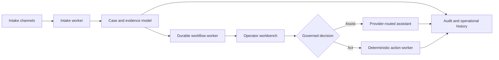

# Conductor: Intelligent Case Operations

## Problem and users

Operational casework rarely fails because a team lacks one more chatbot. It fails because intake, evidence, work queues, decisions, communications, external actions, permissions, and audit history drift across disconnected tools.

I designed Conductor as a configuration-first case-operations platform for operators, reviewers, administrators, and platform teams. The product connects intake to understanding, structured work, assistance, and governed action without treating an AI response as authority.

## Constraints and risk boundary

- Local defaults must keep external integrations disabled.
- Production configuration must fail closed when dependencies, identity, storage, or provider values are missing.
- Long-running work needs durable worker roles and explicit database responsibilities.
- Assistance and deterministic actions must remain separate execution boundaries.
- Connected enterprise claims require authorized evidence from real identity, storage, Graph, OCR/LLM, network, and recovery environments.
- Representative-user acceptance is a human gate, not something an agent walkthrough can satisfy.

## Architecture and key decisions

Conductor ships one artifact with separately startable process roles: API, intake worker, durable workflow worker, deterministic action worker, Graph poller, and deployment jobs. This keeps responsibilities explicit while allowing the system to run as a coordinated whole.

The checked-in configuration is deliberately local-only. Graph intake and assistant behavior remain unavailable until their routes are configured. The standalone production profile requires real PostgreSQL, checkpoint storage, versioned object storage, OIDC identity, and an approved provider; it rejects template values instead of falling back to unsafe development behavior.

## What I designed and delivered

- A configuration-first platform boundary spanning intake, cases, queues, review, assistance, and action.
- Independently startable roles with explicit database and checkpoint responsibilities.
- Local/test, standalone, and connected-evidence boundaries.
- Fail-closed configuration generation and readiness diagnostics.
- Operator and administration interfaces with role-aware workflows.
- A readiness vocabulary that separates local proof, connected certification, and human acceptance.
- Reproducible showcase and recovery concepts with evidence-bound manifests.

## Verification evidence

The current default branch directly supports the process-role and fail-closed configuration claims above. The repository also contains a later showcase-readiness record with detailed local gates, simulated-versus-real integration labeling, residual-risk tracking, and separate Level 1, Level 2, and Level 3 verdicts.

The strongest readiness record names a non-default candidate revision. I therefore do not present its large test totals or readiness labels as current-default-branch completion. The portfolio claim is narrower: I designed and implemented a deeply evidenced case-operations architecture with explicit certification boundaries.

## Honest limitations

- Connected Microsoft Graph, workforce identity, production storage, approved OCR/LLM providers, and enterprise recovery remain uncertified without an authorized environment.
- A representative nontechnical-user session remained a separate human acceptance gate in the candidate record.
- Local deterministic and simulated provider behavior is not customer or production evidence.
- The current public-facing case study intentionally excludes private schemas, environment details, and integration configuration.

## Skills demonstrated

Platform architecture, case management, durable workflows, FastAPI, PostgreSQL, LangGraph, React, worker design, identity and permission boundaries, human-in-the-loop operations, configuration systems, observability, release readiness, and evidence-based product governance.

