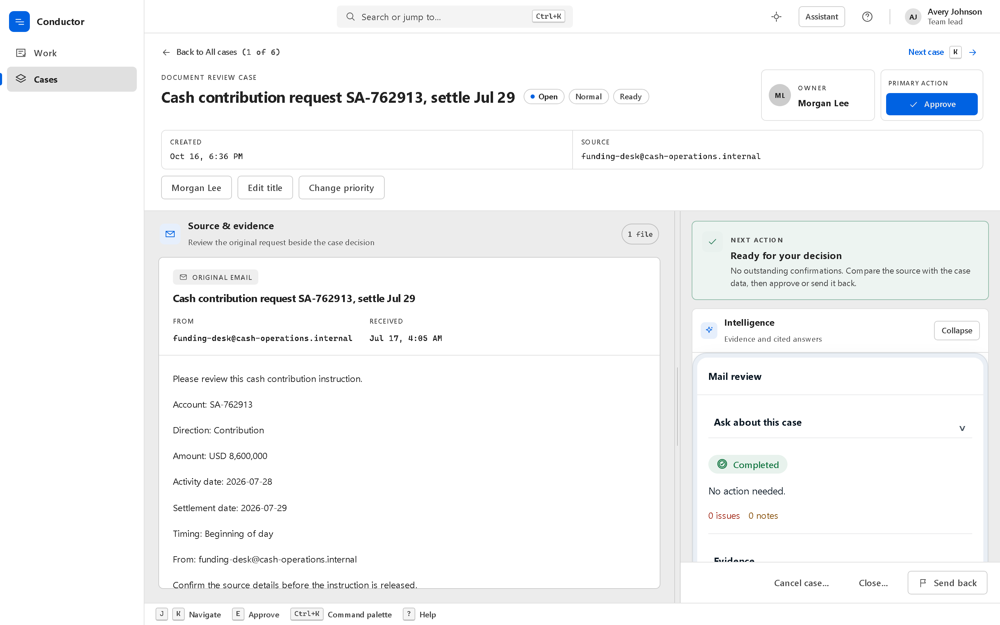
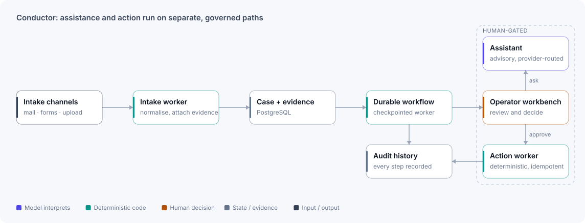

# Conductor

**Case operations from intake to governed action: assistance advises, deterministic workers act, people decide.**

<picture>
  <source media="(prefers-color-scheme: dark)" srcset="../assets/screens/conductor/case-evidence-dark.png">
  
</picture>

A document-review case on synthetic seed data: the original email beside the case decision, its next action, owner and primary action.

| Stack | Evidence | Checked |
|---|---|---|
| Python · FastAPI · LangGraph · PostgreSQL · React | 2,764 Python and 231 UI tests · 19 ADRs | 2026-10-16 |

## The problem

Operational casework rarely fails for lack of another chatbot. It fails because intake, evidence, queues, decisions, communications, external actions, permissions and audit history drift apart across disconnected tools. Conductor is a configuration-first case-operations platform for operators, reviewers, administrators and platform teams. It connects intake to understanding, structured work, assistance and action without treating an AI response as authority.

## Architecture

<picture>
  <source media="(prefers-color-scheme: dark)" srcset="../assets/diagrams/conductor-dark.svg">
  
</picture>

Conductor ships one artifact with separately startable process roles: API, intake worker, durable workflow worker, deterministic action worker, Microsoft Graph poller and deployment jobs. Each role's responsibilities stay explicit, and the system still runs as one coordinated whole.

## Key decisions

- **Assistance and action are separate execution paths.** The assistant can explain and draft. Only the deterministic action worker changes external state. AI proposals always need a person to confirm them, and other actions need approval where policy requires it, a per-action setting. Actions are idempotent, so a retry can't double-act; exactly-once effects still depend on idempotent downstream systems.
- **Fail closed in production.** The checked-in configuration is local-only and keeps integrations disabled. The production profile requires real PostgreSQL, checkpoint storage, S3 object storage, OIDC identity and an approved provider, and it rejects template values instead of falling back to development behaviour.
- **Name the evidence class.** Local validation, connected-system certification and representative-user acceptance are separate gates with separate verdicts. A green local run never stands in for a connected one.

## What I built

- A configuration-first platform spanning intake, cases, queues, review, assistance and action.
- Independently startable worker roles with explicit database and checkpoint responsibilities.
- Fail-closed configuration generation and readiness diagnostics.
- Operator and administration interfaces with role-aware workflows.
- Regression tests for business rules, API contracts, agent and tool behaviour, prompt injection, cross-tenant isolation and failure recovery.

## Evidence

- **Tests (2026-10-16):** 2,764 Python tests passed (80 skipped) and 231 platform-UI tests passed. Architecture, documentation and manifest checks passed. The operator console's own suite had 599 passing and 2 failing tests, from a duplicate-React test setup that is still open.
- **Breadth:** 263 Python test files, 34 Playwright specs and 19 architecture decision records.
- **Release gates:** Level 1 Showcase, Level 2 Release Candidate and Level 3 Enterprise Connected. Only local and simulated evidence is claimed here.

## Scope and limits

- Connected Microsoft Graph, workforce identity, production storage, approved OCR and LLM providers, and enterprise recovery aren't certified. That needs an authorised environment.
- Local deterministic and simulated provider behaviour isn't customer or production evidence.
- A representative non-technical user session is a separate human acceptance gate and isn't claimed here.

[← Back to profile](../README.md)
