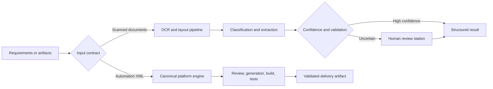

# Enterprise Automation Systems: Review, Document Intelligence, and Delivery

## Problem and users

Enterprise automation teams do more than build bots. They interpret requirements, review platform artifacts, generate tests, package releases, process documents, route uncertainty to people, integrate with existing work systems, and prove that the result is supportable on locked-down machines.

This case study combines recurring engineering patterns across several private tools. It does not claim that they are one deployed customer platform.

## Constraints and risk boundary

- Platform artifacts must be parsed and validated by a canonical engine rather than duplicated ad hoc.
- Unsupported files must be refused with a clear reason.
- Document extraction confidence must route uncertainty to a human instead of silently accepting it.
- Optional AI providers must remain swappable and visibly unconfigured when unavailable.
- Windows utilities must work without assuming admin rights or fragile native dependencies.
- Client data, credentials, employer configuration, and deployment claims stay private.

## Architecture and key decisions

The shared pattern is explicit contracts around uncertain or platform-specific work. Blue Prism Workbench routes XML parsing, generation, validation, layout, and release packaging through one engine client. Scribe exposes one OCR engine through both a headless JSON CLI and a desktop GUI. OpenVantage separates OCR, classification, extraction, confidence, and human review so heavier models can change without reshaping the pipeline.

## What I designed and delivered

- A Blue Prism workbench for deterministic review, artifact generation, release building, explanation, and test-case export.
- Isolation of Blue Prism XML knowledge behind one engine boundary.
- Swappable model-provider adapters with visible configuration status.
- A no-admin OCR utility with one shared engine, deterministic page processing, a stable JSON contract, and desktop delivery.
- A CPU-first document pipeline with classification, schema extraction, tables, calibration, and a revision-aware human review station.
- Delivery tooling for project intake, evidence organization, review gates, timeline tracking, and presentation-safe exports.

## Verification evidence

The current Blue Prism Workbench README and head commit report 154 passing unit tests and no system-library dependency for its PDF fixtures. Its documented capabilities include 31 Blue Prism rules, validated artifact generation, a requirements-driven build workspace, and test exports.

Scribe and OpenVantage both contain extensive test suites and current architecture documentation. Their checked-in count wording is inconsistent with their current head commit messages, so I intentionally omit exact test totals from the public claim until those repositories are refreshed. The architecture and fail-safe routing claims are directly observable in current source documentation.

## Honest limitations

- This is a portfolio of related tools, not evidence of one customer deployment.
- OpenVantage explicitly does not claim drop-in accuracy equivalence to a tuned commercial document platform.
- Heavy OCR, layout, table, and model weights are optional in parts of the toolset.
- Real Jira, Outlook, SharePoint, identity, or customer-environment acceptance is not claimed here.

## Skills demonstrated

Blue Prism, RPA architecture, Python, FastAPI, React, TypeScript, XML contracts, code generation, OCR, confidence calibration, human review, Windows packaging, provider abstraction, document security, delivery governance, and testable enterprise integration boundaries.

