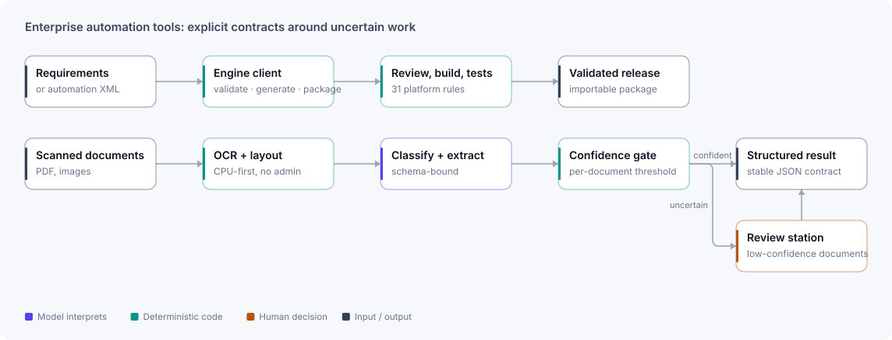

# Enterprise automation tooling

**Tools for the engineering work around RPA delivery: artifact review, release building, OCR, and document extraction with human review.**

⟦HERO⟧

| Project | My role | Stack | Evidence |
|---|---|---|---|
| Three related private tools, shown here with synthetic data only. Not one deployed customer platform. | Sole designer and engineer | Python · FastAPI · React · TypeScript · Blue Prism XML · OCR | ⟦EVIDENCE-STRIP⟧ |

## The problem

Enterprise automation teams do more than build bots. They interpret requirements, review platform artifacts, package releases, process documents, route uncertainty to people, and prove the result can be supported on locked-down machines. These tools turn recurring parts of that work into explicit, testable contracts.

## Architecture

<picture>
  <source media="(prefers-color-scheme: dark)" srcset="../assets/diagrams/enterprise-automation-dark.svg">
  
</picture>

## The tools

| Tool | What it does |
|---|---|
| **Blue Prism Workbench** | Deterministic review of Blue Prism processes and objects, artifact generation, release building, plain-language explanation and test-case export. All XML parsing, generation, validation, layout and packaging go through one engine client. |
| **Scribe** | A no-admin OCR utility. One OCR engine sits behind both a headless JSON CLI and a desktop app, with deterministic page processing and a stable output contract. |
| **OpenVantage** | A CPU-first document pipeline: OCR, classification, schema-bound extraction, tables and calibrated confidence, with a revision-aware human review station. Each stage can swap in a heavier model without reshaping the pipeline. |

## Key decisions

- **One engine per platform format.** All Blue Prism XML knowledge sits behind one engine boundary, so review, generation, validation and packaging can't disagree about what a file means.
- **Uncertainty routes to a person.** Extraction confidence is calibrated, and fields below threshold go to a review station instead of being accepted silently.
- **Work on locked-down machines.** The OCR utility needs no admin rights or fragile native dependencies, and heavy model weights are optional.

## Evidence

⟦EVIDENCE⟧

## Scope and limits

- These are related tools, not evidence of a single customer deployment.
- OpenVantage doesn't claim accuracy parity with a tuned commercial document platform.
- No real Jira, Outlook, SharePoint, identity or customer-environment acceptance is claimed here.

[← Back to profile](../README.md)
