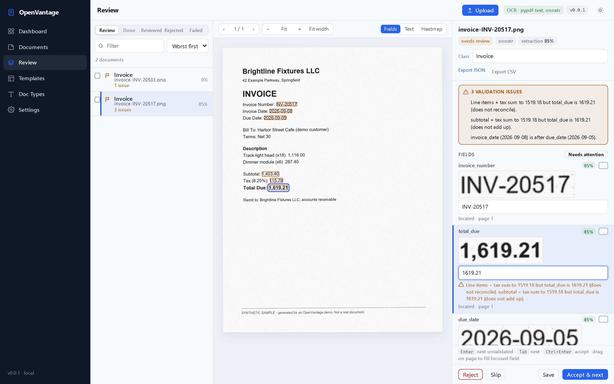
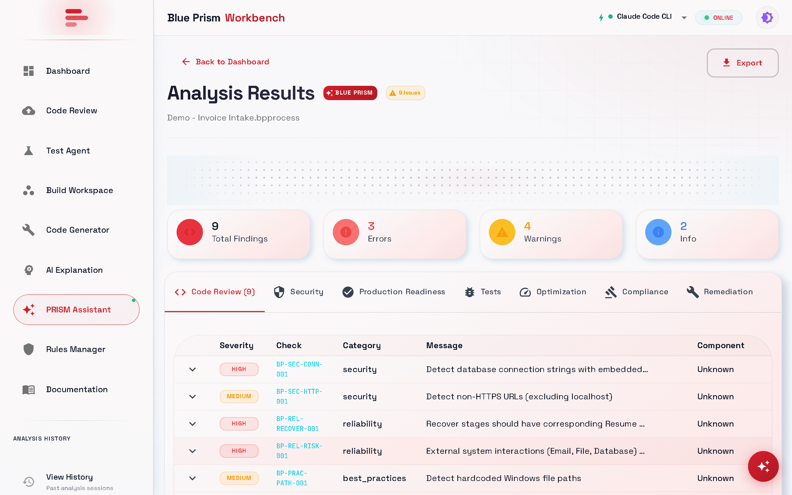

# Enterprise automation tooling

**Tools for the engineering work around RPA delivery: artifact review, release building, OCR, and document extraction with human review.**

Three related private tools, shown here with synthetic data only. They aren't one deployed customer platform.

<picture>
  <source media="(prefers-color-scheme: dark)" srcset="../assets/screens/enterprise/openvantage-review-station-dark.png">
  
</picture>

Historical synthetic OpenVantage review capture. Current acceptance refuses while validation issues remain; corrections must be saved and rechecked. The pictured acceptance wording is stale.

| Stack | Evidence | Checked |
|---|---|---|
| Python · FastAPI · React · TypeScript · Blue Prism XML · OCR | Separate local tool evidence; no combined customer acceptance | 2026-10-28 copy audit |

## The problem

Enterprise automation teams do more than build bots. They interpret requirements, review platform artifacts, package releases, process documents, route uncertainty to people, and prove the result can be supported on locked-down machines. These tools turn recurring parts of that work into explicit, testable contracts.

## Architecture

<picture>
  <source media="(prefers-color-scheme: dark)" srcset="../assets/diagrams/enterprise-automation-dark.svg">
  
</picture>

## The tools

| Tool | What it does |
|---|---|
| **Blue Prism Workbench** | Deterministic review of Blue Prism processes and objects, artifact generation, release building, plain-language explanation and test-case export. Local GeneratorRegistry adapters emit `.bpobject` and `.bpprocess` component XML; the separate engine handles validation/build operations and `bp_engine_client.package` assembles `.bprelease` files. Rule review remains separate. |
| **Scribe** | A no-admin OCR utility. One OCR engine sits behind both a headless JSON CLI and a desktop app, with deterministic page processing and a stable output contract. |
| **OpenVantage** | A CPU-first document pipeline: OCR, classification, schema-bound extraction and tables, with optional OCR-confidence calibration and a revision-aware human review station. Each stage can swap in a heavier model without reshaping the pipeline. |

## Key decisions

- **Make component and engine boundaries explicit.** Local GeneratorRegistry adapters produce component XML. The separate engine validates and builds artifacts, and its package operation assembles releases. Rule-based review has a separate path; this is not a claim that one engine owns every interpretation of XML.
- **Uncertainty routes to a person.** Documents with low confidence, failed validators or inconsistent fields go to a review station instead of being accepted silently. OCR confidence can be calibrated; extraction confidence is left uncalibrated by design.
- **Work on locked-down machines.** Scribe has a no-admin packaging path with pinned, hash-checked Tesseract and Poppler dependencies; this is not a current qualified native bundle. OpenVantage keeps heavy model weights optional.

## Evidence

- **Blue Prism Workbench:** `blueprism-workbench@e9007863891c0bbb02754cefdfbc3c38a3608353:docs/evidence.md` documents 31 review rules across eight categories and the component-generation/engine boundary (BPW-02). The screenshot is a static synthetic capture, not proof of repeatable runs; the older aggregate pass count is omitted because raw output is absent.
- **OpenVantage:** `openvantage@4539cfa6c7940c38ae1515aaa8b49fd4cc29df74:docs/evidence.md` and `TESTS.md` retain local test records. Acceptance stays blocked while validation issues remain: save corrections and recheck. The older capture does not establish the current issue count or acceptance UI. No current accuracy or customer-acceptance result is inferred.
- **Scribe:** `Scribe@fef08e082a6c9982a6eb425916f3a7ff450d5f47:docs/evidence.md` (SCR-03) records 335 passes, no skips and no failures on 2026-10-25 at source `2a552c3791f062a112a26d57d45bdead03720240`. The prior degraded-scan failure report is historical and is not asserted to remain open. This result does not qualify native packaging.

Blue Prism Workbench reviewing a hand-written synthetic process: 9 findings with rule IDs, categories and messages.

## Scope and limits

- These are related tools, not evidence of a single customer deployment.
- OpenVantage doesn't claim accuracy parity with a tuned commercial document platform.
- No real Jira, Outlook, SharePoint, identity or customer-environment acceptance is claimed here. Test-case export writes Jira, Xray and Azure DevOps files; it isn't a live integration.

[← Back to profile](../README.md)
