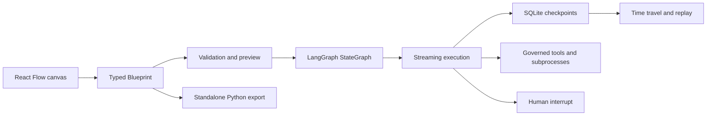

# GraphForge: Visual Agent-Graph Engineering

## Problem and users

Agent workflows become difficult to trust when their state, routing, tools, checkpoints, and failure behavior exist only in handwritten code. Visual builders can improve understanding, but many stop at diagrams or mocked execution and cannot produce a portable implementation.

I designed GraphForge for engineers and technical operators who want to author stateful agent graphs visually, execute the real runtime, inspect what happened, pause for human decisions, and export runnable Python.

## Constraints and risk boundary

- The canvas must map to a typed, validated graph contract rather than arbitrary visual state.
- Runtime evidence must come from genuine LangGraph execution, not an animation.
- Tool and code nodes need containment and explicit governance.
- Human interrupts and checkpoint replay must be first-class workflow concepts.
- AI-assisted graph changes must be previewed and validated before application.
- Evaluation must name partial failures instead of rounding them into a success claim.

## Architecture and key decisions

The Blueprint is the system boundary. The visual editor, assistant, validator, runtime, and exporter share that contract. This keeps the canvas from becoming an untestable alternate implementation of the workflow.

Execution compiles to the real LangGraph runtime with streaming, checkpoints, and interrupts. A workflow can pause for review, record an edited decision, resume, replay from an earlier checkpoint, and export outside the product.

## What I designed and delivered

- A typed visual authoring surface over React Flow.
- Real LangGraph execution with streaming state and checkpoint history.
- Human-in-the-loop interrupts and replay from prior checkpoints.
- Blueprint validation, deterministic graph drafting, and plan previews.
- Governed HTTP, MCP, code, and tool-node boundaries.
- Runnable standalone Python export.
- Regenerable walkthrough recordings whose captions are tied to asserted states.
- A receiver-verifiable source archive.

## Verification evidence

A dated live evaluation generated on 2026-08-10 recorded:

- 100% correctness across the evaluated cases.
- 100% adversarial containment, compile completeness, and validator faithfulness.
- 94.4% execution completeness against a 90% threshold.
- One named failure in a human-interrupt change-approval case, caused by a missing required input.

The run used an authenticated subscription CLI and a real local governed MCP stdio process. API-style cost was intentionally reported as unavailable because the model ran through a subscription CLI. These figures are retained with their date, environment, and failure; they are not generalized beyond that evaluation set.

## Honest limitations

- The dated evaluation contained one execution failure.
- Model calls were slow enough that walkthroughs disclose when waits are accelerated.
- Subscription CLI execution does not provide comparable per-call API pricing.
- Local tool and MCP evidence is not proof of a production sandbox or multi-tenant deployment.
- Exported code still needs normal engineering review, dependency management, and deployment controls.

## Skills demonstrated

Agent orchestration, LangGraph, typed contracts, React, Python, streaming systems, checkpointing, human-in-the-loop design, MCP, subprocess containment, code generation, adversarial evaluation, developer experience, and reproducible demonstrations.

