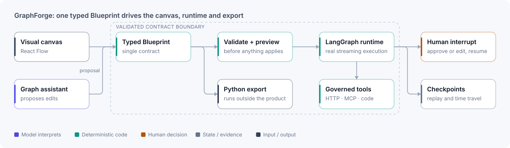

# GraphForge

**Visually author, run, inspect and export stateful LangGraph workflows.**

⟦HERO⟧

| Project | My role | Stack | Evidence |
|---|---|---|---|
| Personal project, built outside client environments | Sole designer and engineer | Python · LangGraph · FastAPI · React · React Flow · SQLite | ⟦EVIDENCE-STRIP⟧ |

## The problem

Agent workflows are hard to trust when their state, routing, tools, checkpoints and failure behaviour live only in handwritten code. Visual builders help people understand a graph, but most stop at a diagram or a mocked run and can't produce something you can deploy. GraphForge is for engineers and technical operators who want to draw a stateful agent graph, run the real runtime, pause for human decisions, inspect what happened, and leave with runnable Python.

## Architecture

<picture>
  <source media="(prefers-color-scheme: dark)" srcset="../assets/diagrams/graphforge-dark.svg">
  
</picture>

The typed Blueprint is the system boundary. The canvas, the assistant, the validator, the runtime and the exporter all read and write that one contract, so the canvas can't drift into an untestable second implementation of the workflow.

## Key decisions

- **Compile to the real runtime, not an animation.** Runs execute LangGraph with streaming state, checkpoints and interrupts, so what you watch on the canvas is the execution itself. The cost: model calls make demos slow, and the walkthroughs say when a wait has been sped up.
- **The assistant proposes; validation decides.** AI-drafted graph changes appear as a preview and only apply after the Blueprint validates. This takes a little longer than direct edits, but the graph is never left half-valid.
- **Govern every side effect.** HTTP, MCP, code and tool nodes run behind explicit boundaries and containment, so an adversarial node can't reach past what the graph declares.

## What I built

- A typed visual authoring surface over React Flow, with deterministic graph drafting and plan previews.
- Real LangGraph execution with streaming state, SQLite checkpoint history, human-in-the-loop interrupts and replay from any earlier checkpoint.
- Governed HTTP, MCP, code and tool nodes.
- Standalone Python export that runs outside the product.
- Regenerable walkthrough recordings whose captions are tied to asserted UI states.

## Evidence

⟦EVIDENCE⟧

## Scope and limits

- Local tool and MCP evidence isn't proof of a production sandbox or a multi-tenant deployment.
- Runs through a subscription CLI don't report comparable per-call API cost, so cost is reported as unavailable rather than estimated.
- Exported code still needs normal review, dependency management and deployment controls.

[← Back to profile](../README.md)
