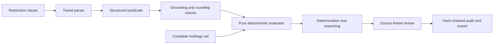

# Mandate Guard: Governed AI Decisioning

## Problem and users

Investment restrictions are usually written in natural language, while compliance decisions must be deterministic, explainable, and reconstructable. Letting a language model make the final decision creates an unstable control surface: the same clause can produce different interpretations, and an apparently reasonable answer may not be tied to every holding it affects.

I designed Mandate Guard for compliance reviewers and engineering teams who need model-assisted interpretation without transferring decision authority to the model.

## Constraints and risk boundary

- A model may interpret a clause, but it must never decide compliance.
- Every decision must cover the full in-scope portfolio rather than a convenient subset.
- Document analysis must stay local by default and require explicit confirmation before authorized provider egress.
- Original files, local paths, and credentials must never be included in a model request.
- Review exports must retain exact source provenance after mutable workspace data is reset.
- Audit evidence must distinguish tamper-evident history from tamper-proof storage.

## Architecture and key decisions

The language model is outside the final decision function. It produces a structured predicate; deterministic code scopes holdings, aggregates exposure, applies thresholds, and emits the determination. This makes the decision path testable and repeatable even when model parsing requires additional controls.

The document-review workspace follows the same boundary. Files are extracted and reviewed locally. If a provider route is configured, the app names it and asks for explicit first-session confirmation before sending bounded extracted text. Missing documents, conflicting evidence, or context overflow stop the operation instead of silently narrowing the input.

## What I designed and delivered

- Tiered restriction parsing with grounding and roundtrip validation.
- A pure deterministic evaluation path over complete holdings sets.
- Entitlement, retrieval zoning, redaction, injection handling, kill-switch, and audit controls.
- A standalone source-linked document-review workspace with local storage and explicit egress consent.
- JSON and HTML exports that snapshot source ID, filename, role, and SHA-256.
- Determinism, routing, retrieval, latency, and boundary evaluation artifacts.
- A self-verifying source archive that records integrity drift instead of hiding it.

## Verification evidence

The current repository reports a scoped benchmark of 384 determinations across 16 restrictions and 24 portfolios, covering 2,000 holding-level evaluations from four model calls. Its committed evidence reports zero determination differences over five runs and a stable audit-chain head.

That is a repository-reported benchmark for the documented data and revision, not a claim that every future clause is deterministic. The repository also includes merged fixes for complete document provenance, context-boundary refusal, no-claim exports, and source-manifest preservation.

## Honest limitations

- The standalone local app does not yet provide authentication or rate limiting.
- The retrieval reranker was tuned on its evaluation set rather than a held-out split.
- The audit chain is tamper-evident, not tamper-proof.
- No human currently approves every cached predicate before it is reused across portfolios.
- Provider-backed analysis needs configured credentials and explicit authorization; it was not exercised for this portfolio.
- The system assists compliance review; it does not replace accountable human or legal judgment.

## Skills demonstrated

Governed AI, deterministic decision systems, document intelligence, retrieval, model grounding, human review, privacy and egress controls, FastAPI, Python, audit design, evaluation methodology, reproducible releases, and financial-domain risk reasoning.

