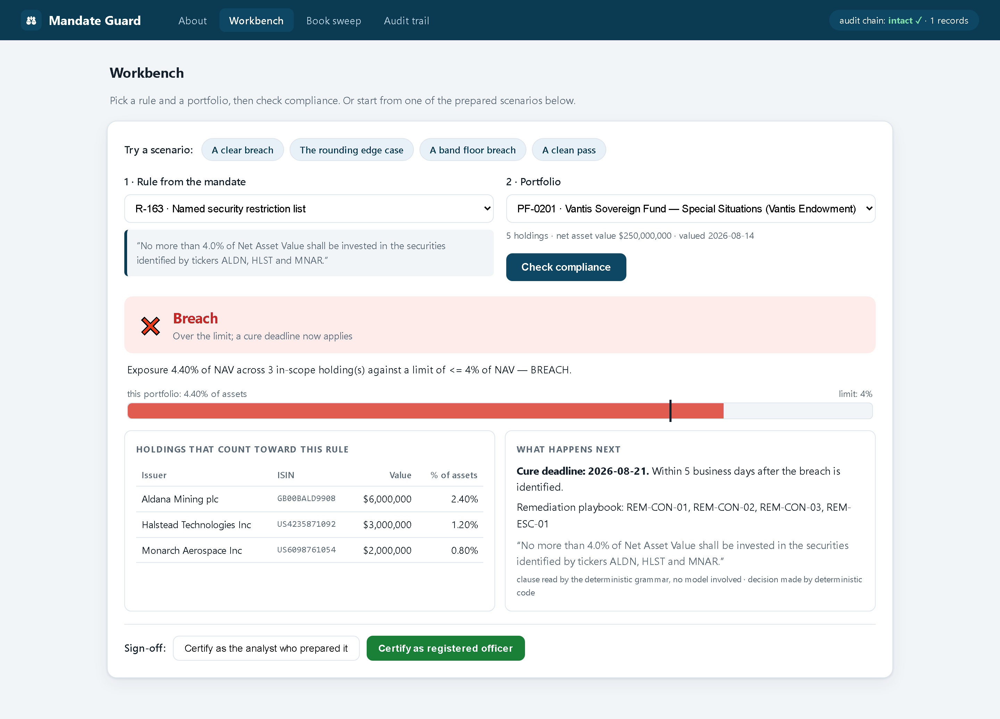

# Mandate Guard

**Investment restrictions turned into predicates, decided by deterministic code, reviewed by a person.**

The document-review workspace on a synthetic agreement and waiver. Each conclusion links to the passage it rests on, and a reviewer must confirm the interpretation.

| Stack | Evidence | Checked |
|---|---|---|
| Python · FastAPI · hybrid retrieval · LLM parsing · MCP · vanilla JS | 384 determinations, 0 differences over 5 runs · 172 tests | 2026-10-16 |

## The problem

Investment restrictions are written in natural language, but compliance decisions have to be deterministic, explainable and reconstructable. If a language model makes the final call, the same clause can produce different answers, and a reasonable-sounding answer may not cover every holding it affects. Mandate Guard is for compliance reviewers and engineering teams who want help interpreting clauses without handing decision authority to a model.

## Architecture

<picture>
  <source media="(prefers-color-scheme: dark)" srcset="../assets/diagrams/mandate-guard-dark.svg">
  
</picture>

The model sits outside the decision function. A deterministic grammar reads most clauses (14 of the 16 in the reference set), and the model proposes a structured predicate only for the rest. Deterministic code then scopes the holdings, aggregates exposure, applies thresholds and emits the determination, so the decision path can be tested and replayed.

## Key decisions

- **The model never decides compliance.** It proposes a predicate only when the grammar can't read a clause, and that predicate must pass grounding and roundtrip checks before anything evaluates it. Given the same validated predicate and holdings, the evaluator returns the same determination. A wrong predicate can still produce a wrong result, which is why review stays human.
- **Evaluate the whole portfolio, every time.** Determinations cover the complete in-scope holdings set rather than a convenient sample, so no holding falls outside a decision.
- **Local by default, explicit egress.** Documents are extracted and reviewed locally. If a provider route is configured, the app names it and asks for confirmation before sending bounded extracted text. It never sends original files, local paths or credentials. Missing documents and context overflow stop the operation, and conflicting evidence holds it for human review, instead of quietly narrowing the input.

## What I built

- Tiered restriction parsing with grounding and roundtrip validation.
- A pure deterministic evaluator over complete holdings sets.
- Entitlement, retrieval zoning, redaction, prompt-injection handling, a kill switch and audit controls.
- A source-linked document-review workspace with local storage and explicit egress consent.
- Review-memo exports (JSON, CSV and HTML) that snapshot each source's ID, filename, role and SHA-256.
- An MCP server that applies the same entitlement, guardrail, kill-switch and audit controls.
- Evaluation artifacts for determinism, routing, retrieval, latency and boundary behaviour.

## Evidence

- **Determinism (2026-10-16):** one sweep evaluates all 16 restrictions against all 24 synthetic portfolios, 384 determinations: 180 compliant, 23 breaches and 181 referred to a person. Across five runs, 0 determinations differed and the audit chain head was identical. 15 of 15 boundary cases stayed stable in outcome and reasoning.
- **Model use:** the reference walkthrough needed 4 model calls in total, about USD 0.0000645 per determination, because the grammar reads most clauses.
- **Tests:** 172 offline tests passed (108 platform, 64 document review).

One rule against one synthetic portfolio, decided in code: 4.40% exposure against a 4% limit, the in-scope holdings, the cure deadline and the remediation playbook.

## Scope and limits

- Repeatable determinations show repeatability, not clause-level accuracy. A wrong model-generated predicate can still produce a wrong result.
- The retrieval reranker was tuned on its evaluation set. Recall needs a held-out split before it generalises.
- Cached predicates aren't individually approved by a person before they're reused across portfolios.
- The audit chain is tamper-evident, not tamper-proof.
- The standalone local app has no authentication or rate limiting yet.
- It supports compliance review. It doesn't replace accountable human or legal judgment.

[← Back to profile](../README.md)
