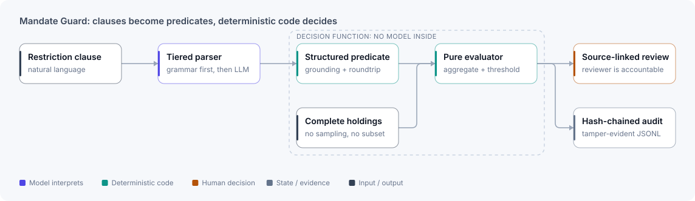

# Mandate Guard

**Investment restrictions interpreted by a model, decided by deterministic code, reviewed by a person.**

⟦HERO⟧

| Project | My role | Stack | Evidence |
|---|---|---|---|
| Personal project, built outside client environments | Sole designer and engineer | Python · FastAPI · hybrid retrieval · LLM parsing · React | ⟦EVIDENCE-STRIP⟧ |

## The problem

Investment restrictions are written in natural language, but compliance decisions have to be deterministic, explainable and reconstructable. If a language model makes the final call, the same clause can produce different answers, and a reasonable-sounding answer may not cover every holding it affects. Mandate Guard is for compliance reviewers and engineering teams who want help interpreting clauses without handing decision authority to a model.

## Architecture

<picture>
  <source media="(prefers-color-scheme: dark)" srcset="../assets/diagrams/mandate-guard-dark.svg">
  
</picture>

The model sits outside the decision function. It turns a clause into a structured predicate. Deterministic code then scopes the holdings, aggregates exposure, applies thresholds and emits the determination, so the decision path can be tested and replayed.

## Key decisions

- **The model never decides compliance.** It produces a predicate that must pass grounding and roundtrip checks before anything evaluates it. Given the same validated predicate and holdings, the evaluator returns the same determination. A wrong predicate can still produce a wrong result, which is why review stays human.
- **Evaluate the whole portfolio, every time.** Determinations cover the complete in-scope holdings set rather than a convenient sample, so no holding falls outside a decision.
- **Local by default, explicit egress.** Documents are extracted and reviewed locally. If a provider route is configured, the app names it and asks for confirmation before sending bounded extracted text. It never sends original files, local paths or credentials. Missing documents, conflicting evidence or context overflow stop the operation instead of quietly narrowing the input.

## What I built

- Tiered restriction parsing with grounding and roundtrip validation.
- A pure deterministic evaluator over complete holdings sets.
- Entitlement, retrieval zoning, redaction, prompt-injection handling, a kill switch and audit controls.
- A source-linked document-review workspace with local storage and explicit egress consent.
- JSON and HTML exports that snapshot each source's ID, filename, role and SHA-256.
- Evaluation artifacts for determinism, routing, retrieval, latency and boundary behaviour.

## Evidence

⟦EVIDENCE⟧

## Scope and limits

- Repeatable determinations show repeatability, not clause-level accuracy. A wrong model-generated predicate can still produce a wrong result.
- The retrieval reranker was tuned on its evaluation set. Recall needs a held-out split before it generalises.
- Cached predicates aren't individually approved by a person before they're reused across portfolios.
- The audit chain is tamper-evident, not tamper-proof.
- The standalone local app has no authentication or rate limiting yet.
- It supports compliance review. It doesn't replace accountable human or legal judgment.

[← Back to profile](../README.md)
