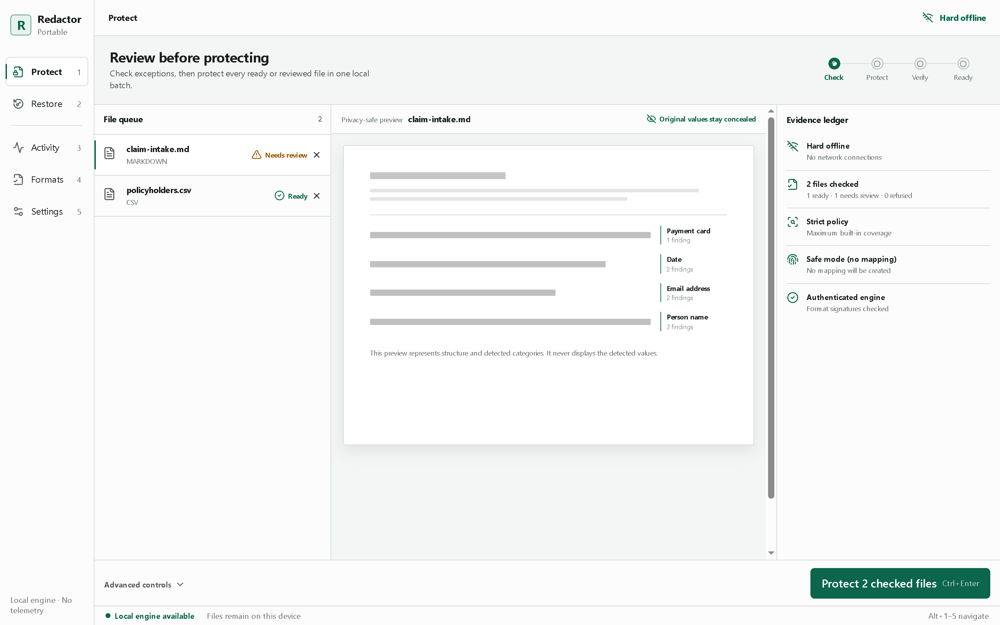
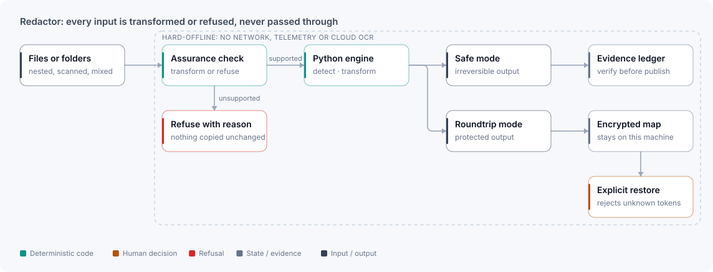

# Redactor

**Hard-offline de-identification: every file is protected or refused, never passed through.**

<picture>
  <source media="(prefers-color-scheme: dark)" srcset="../assets/screens/redactor/redactor-review-dark.png">
  
</picture>

The packaged app reviewing two synthetic files before protecting them. The preview shows detected categories, never the values.

| Stack | Evidence | Checked |
|---|---|---|
| Python · Rust · Tauri · React · portable Windows packaging | 417 Python tests · packaged app run end to end | 2026-10-16 |

## The problem

Teams want realistic documents for AI, analytics, testing and review without exposing the people and organisations inside them. A regex pass isn't enough. Files can be scanned, nested, malformed, encrypted or structurally ambiguous, and a copy that looks successful can be more dangerous than a clear refusal. Redactor is a local file-protection product for privacy-conscious operators, developers and regulated-workflow teams.

## Architecture

<picture>
  <source media="(prefers-color-scheme: dark)" srcset="../assets/diagrams/redactor-dark.svg">
  
</picture>

One authoritative Python engine owns detection, transformation, refusal and evidence semantics. The Tauri/Rust desktop shell and other integrations consume versioned contracts instead of reimplementing the privacy rules.

## Key decisions

- **Transform, recurse or refuse.** Every input gets classified. "Copied because the parser couldn't understand it" is never a success state. Legacy Office binaries, macro-enabled files, encrypted PDFs and unknown binaries are refused with a reason.
- **Irreversible by default.** Safe mode can't be undone. Roundtrip mode writes a separate, authenticated, encrypted restoration map that never travels with the protected files, and restore rejects malformed, unknown or ambiguous tokens. Tokens an LLM simply left out of its answer are allowed.
- **All or nothing for folders.** Directory jobs stage their outputs, and one failed item stops the set from being published as complete and safe.

## What I built

- A cross-platform Python engine and CLI with fail-closed format handling.
- A portable Windows desktop app that needs no admin install, with local engine authentication and a constrained WebView.
- Separate Safe and Roundtrip workflows, including a review of the restoration impact.
- Evidence ledgers, report schemas, dependency inventories, SBOM material and release verification.
- A source-release path that reopens its own archive and verifies every member's hash.

## Evidence

- **Tests (2026-10-16):** 417 Python tests passed (12 skipped), Ruff was clean, and release verification passed on the source tree.
- **Packaged app:** the portable build was made from source and driven end to end on synthetic files: Safe protect, Roundtrip protect, and restore of an LLM answer (18 mapping entries authenticated, 3 tokens restored, 0 unresolved).
- **Refusals:** the CLI refuses a legacy `.xls` and a macro-enabled `.docm`, each with a stated reason.

## Scope and limits

- Detection isn't infallible. OCR evidence so far is English-focused, and handwriting or low-quality scans can still be missed.
- Safe projection can reduce visual fidelity for some formats.
- In the desktop app, a `.docm` shows as ready at the check step and is refused only at protect, and a refused file added on its own fails the whole check with a generic message rather than a per-file reason.
- Redactor is a privacy engineering tool, not a legal determination or a compliance certification.

[← Back to profile](../README.md)
