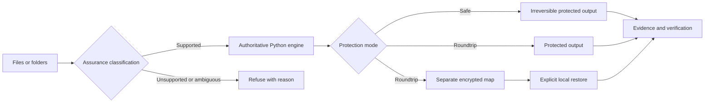

# Redactor: Hard-Offline De-identification

## Problem and users

Teams often need to use realistic documents in AI, analytics, testing, or review workflows without disclosing the people and organizations inside them. A simple regex pass is not enough: files can be scanned, nested, malformed, encrypted, or structurally ambiguous, and a "successful" copy can be more dangerous than an explicit refusal.

I designed Redactor as a local file-protection product for privacy-conscious operators, developers, and regulated-workflow teams. It supports irreversible protection by default and controlled restoration only when that capability is intentionally requested.

## Constraints and risk boundary

- Runtime processing must not depend on cloud OCR, hosted models, telemetry, update checks, or network services.
- Unsupported, encrypted, damaged, or ambiguous formats must fail closed rather than pass through unchanged.
- A reversible workflow must never create a cleartext recovery map implicitly.
- One failed item in a directory job must prevent staged outputs from being published as a complete safe result.
- Windows delivery must work without requiring an administrator-managed installation path.
- Verification must separate parser behavior, detection quality, output integrity, UI behavior, and observed offline runtime.

## Architecture and key decisions

The authoritative engine owns detection, transformation, refusal, and evidence semantics. A Tauri/Rust desktop shell and other integrations consume versioned contracts rather than reimplementing the privacy rules.

The most important product decision is the assurance classification. Every input must be transformed, recursively processed, or refused. "Copied because the parser could not understand it" is not an acceptable success state.

Safe mode is intentionally irreversible. Roundtrip mode creates a separate authenticated, encrypted restoration map; the map never accompanies protected files to an AI system. Restoration rejects missing, malformed, unknown, or ambiguous tokens.

## What I designed and delivered

- A cross-platform Python engine and command-line interface with fail-closed format handling.
- A portable Windows desktop experience with local engine authentication and constrained WebView behavior.
- Separate Safe and Roundtrip workflows, including explicit restoration-impact review.
- Directory-level staging so partial failure cannot be mistaken for a complete protected set.
- Evidence ledgers, report schemas, dependency inventories, SBOM material, and release verification.
- Multi-runtime contract boundaries for desktop and integration surfaces.
- A source-release path that reopens its own archive and verifies every member hash.

## Verification evidence

A dated 2026-08-16 release record documented independent gates rather than one aggregate "green" status. At that checkpoint, the repository recorded:

- 325 Python tests plus 21 extension subtests.
- 30 desktop unit, component, and contract checks.
- 33 Rust unit tests with warnings denied by Clippy.
- 196 complete-workflow browser checks.
- 565 production-bundle visual-matrix checks.
- A 53-fixture corpus with expected outcomes and no damaged controls.
- Portable release and observed hard-offline process checks.

Those counts describe that dated release checkpoint, not a fresh rerun of the current head. The current source still contains the evidence index and reproduction commands, but I keep the historical scope explicit.

## Honest limitations

- Detection is not infallible.
- The first portable OCR evidence was English-focused; handwriting and low-quality scans can still be missed.
- Legacy Office binaries, macro-enabled Office files, encrypted PDFs, and unknown binaries are refused.
- Safe projection can change visual fidelity for some formats.
- Native Windows 11 Mica remained an unobserved physical-hardware evidence class in the dated release record.
- Redactor is a privacy engineering tool, not a legal determination or compliance certification.

## Skills demonstrated

Privacy architecture, offline assurance, fail-closed design, encrypted data formats, Python, Rust, Tauri, React, Windows packaging, multi-runtime contracts, evidence engineering, supply-chain review, accessibility, and release verification.
