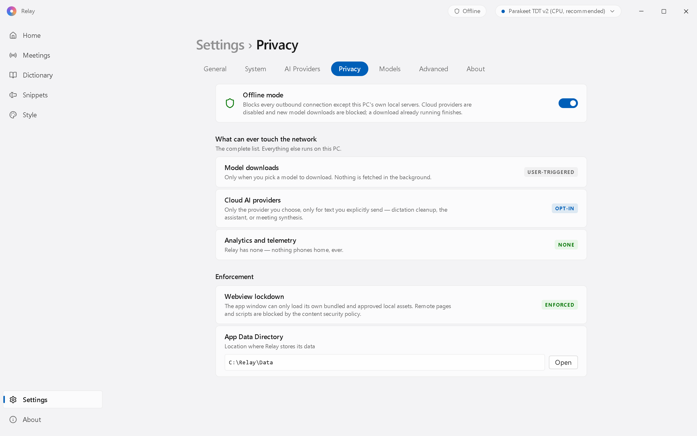
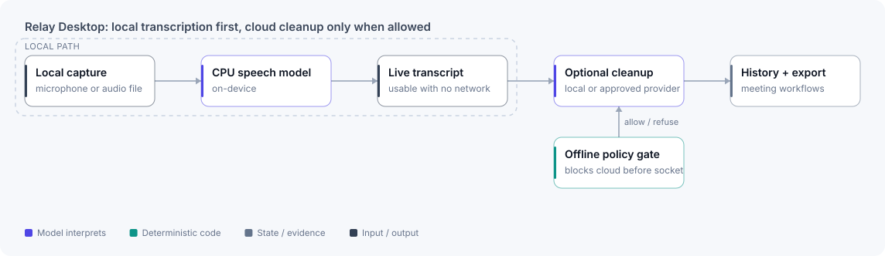

# Relay Desktop

**Local Windows dictation and meeting notes: on-device speech recognition first, cloud cleanup only when allowed.**

A Windows-focused adaptation of the MIT-licensed [Handy](https://github.com/cjpais/Handy).

<picture>
  <source media="(prefers-color-scheme: dark)" srcset="../assets/screens/relay/relay-privacy-dark.png">
  
</picture>

Settings, Privacy: offline mode on by default and the complete list of features that can touch the network. Captured from the app UI with sample data and a test-harness backend; live transcription isn't shown.

| Stack | Evidence | Checked |
|---|---|---|
| Rust · Tauri · React · sherpa-onnx speech recognition | 120 unit and 9 Playwright UI tests | 2026-10-16 |

## The problem

Voice tools often trade privacy for convenience, require cloud accounts, or perform poorly on ordinary Windows hardware. People on locked-down or privacy-sensitive machines need dictation and meeting support that works without a GPU, administrator access or mandatory cloud processing.

## What's upstream and what's mine

Relay started as a fork of Handy, an MIT-licensed open-source speech-to-text app, which supplied the Tauri shell, the audio pipeline and the settings foundation. Handy's credit and license are kept in the repository. Relay adds:

- **A CPU-first engine:** sherpa-onnx Parakeet TDT with a segment-incremental pipeline.
- **Offline mode as an enforced policy:** cloud routes are refused before a socket opens, and loopback stays allowed.
- **Meetings:** microphone and system-audio capture in one transcript, opt-in live notes, agenda readiness, questions about the meeting, and a handoff package written to a local project folder.
- **Windows paste hardening:** clipboard-sequence checks and a paste fallback that respects Windows integrity levels.
- **The Windows 11 interface,** portable packaging with a version guard, and command-line meeting controls.

## Architecture

<picture>
  <source media="(prefers-color-scheme: dark)" srcset="../assets/diagrams/relay-dark.svg">
  
</picture>

Transcription and cleanup are separate paths. Local speech recognition produces usable text without a hosted model. Cleanup is optional, and a network policy decides each route, treating loopback and external destinations differently.

## Key decisions

- **Local transcription is the flagship path.** Everything useful works offline, and cloud cleanup is an optional extra.
- **Block before the socket.** Offline mode refuses cloud providers and model downloads before a connection opens, while still allowing loopback services. Refusals are visible, never silently bypassed.
- **Don't claim trust you can't show.** Portable packaging exists, but the build isn't described as signed or trusted until a real certificate and external verification back that up.

## What I built

- Segment-incremental local transcription on CPU.
- A Windows-first Tauri/Rust and React shell with Windows 10 and 11 design tokens, focus handling and responsive fallbacks.
- Offline-mode gates for cloud providers and model downloads.
- Optional local or subscription-backed cleanup adapters with visible status.
- Meeting workflows for questions, agendas, handoffs and transcript history.
- Portable packaging with version and stale-artifact safeguards.

## Evidence

- **Checks (2026-10-16):** lint, format, type and translation checks passed, 120 unit tests passed and 9 Playwright UI tests passed. Rust tests weren't re-run that day.
- **Offline enforcement:** a test confirms a cloud provider is blocked before any socket opens.
- **Speed, recorded honestly:** a 252 ms tail finalize after 60.5 s of audio. The 0.6 s p95 end-to-end target was missed on a laptop without a GPU (518 to 663 ms).

## Scope and limits

- Authenticode signing, SmartScreen reputation and fresh-VM acceptance are deferred until a signing certificate is available.
- CPU transcription speed depends on the model, the device and the audio quality.
- Some cleanup behaviour depends on locally installed or subscription-backed tools.

[← Back to profile](../README.md)
