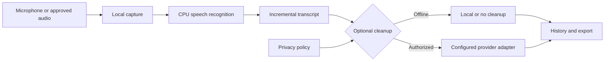

# Relay Desktop: Local Windows Voice Workflows

## Problem and users

Voice tools often trade convenience for privacy, require cloud accounts, or perform poorly on ordinary Windows hardware. Users on locked-down or privacy-sensitive machines need dictation and meeting support that remains useful without a GPU, administrator access, or mandatory cloud processing.

I developed Relay Desktop as a Windows-first local voice product with CPU-efficient transcription, a focused desktop experience, and optional cleanup providers behind explicit privacy controls.

## Constraints and risk boundary

- Local transcription must remain the flagship path.
- Offline mode must block cloud providers before socket use while preserving loopback services.
- Provider failures and refused operations must be visible rather than silently bypassed.
- Desktop UX must feel native on Windows 10 and Windows 11 and remain keyboard accessible.
- Packaging must not be described as trusted or signed without a real certificate and external verification.
- Upstream MIT attribution must remain explicit.

## Architecture and key decisions

The transcription path and cleanup path are separate. Local speech recognition produces usable text without a hosted model. Cleanup providers are optional and evaluated through a network policy that treats loopback and external routes differently.

The desktop uses Tauri/Rust with a React interface. The Windows redesign establishes shell, typography, focus, responsive, and fallback behavior rather than relying on one theme or one machine configuration.

## What I designed and delivered

- Local CPU-oriented speech recognition and segment-incremental transcription.
- A Windows-first Tauri/Rust and React desktop shell.
- Offline-mode gates for cloud providers and model downloads.
- Optional local or subscription-backed cleanup adapters with visible status.
- Meeting-oriented question, agenda, handoff, and transcript-history workflows.
- Accessibility fixes, Windows shell tokens, screen migrations, and responsive evidence.
- Portable packaging with version and stale-artifact safeguards.

## Verification evidence

A revision-scoped privacy checkpoint recorded lint and build success, 354 passing Rust tests, Clippy success, and nine Playwright UI checks. That checkpoint also recorded the initial formatting failure and the subsequent clean rerun rather than hiding the failure.

The same evidence shows two live cleanup-probe outcomes: a contaminated routing environment was refused, while a scrubbed normal-launch environment completed a real subscription CLI cleanup. This supports the routing-safety claim at that revision; it is not a fresh current-head network audit.

## Honest limitations

- Portable packaging exists, but Authenticode, Windows Properties verification, SmartScreen reputation, and fresh-VM acceptance remain deferred until a signing certificate is available.
- Some provider behavior depends on installed local or subscription-backed tools.
- CPU transcription performance varies by model, device, and audio quality.
- The product derives from the MIT-licensed Handy project; the public portfolio must retain that attribution and distinguish adaptation from original upstream work.

## Skills demonstrated

Rust, Tauri, React, Windows desktop engineering, local speech recognition, offline policy enforcement, provider adapters, process isolation, accessibility, responsive UI, test hermeticity, packaging, and evidence-based release boundaries.

